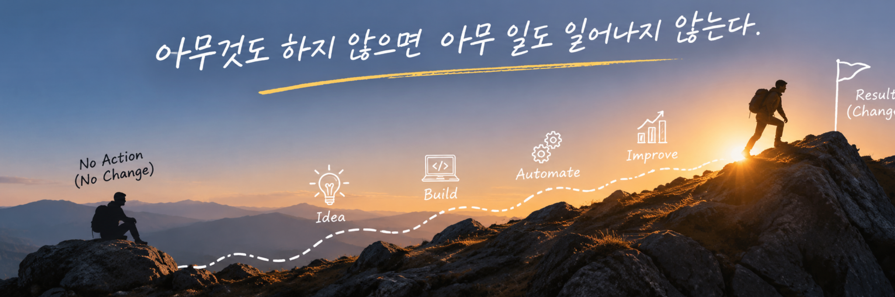

  

# 👋 안녕하세요, 원광재입니다.

건설장비 업계에서 **열유동해석 엔지니어(Thermal & CFD Engineer)**로 일하고 있습니다.

열유동해석을 기반으로 제품의 성능을 분석하고 개선하는 업무를 하고 있으며, 최근에는 **Python, AI, 자동화 기술을 활용한 엔지니어링 업무 효율화**에 관심을 가지고 있습니다.

전문 개발자는 아니지만, 필요한 도구를 직접 만들고 새로운 기술을 배우는 과정을 즐깁니다.

## 🔧 전문 분야 (Engineering)

- **CFD** — 전산유체역학 및 열유동해석
- **Thermal Management** — 장비 열관리 및 냉각 성능 분석
- **HVAC** — 공조 시스템 성능 분석
- **BTMS** — 배터리 열관리 시스템
- **Engineering Automation** — 해석 및 데이터 분석 업무 자동화

## 💻 기술 및 도구 (Tech & Tools)

- **Simulation:** ANSYS Fluent, STAR-CCM+, KULI
- **Programming:** Python
- **Development:** VS Code, Git, GitHub
- **AI:** Local LLM, AI-assisted Development
- **Data Analysis:** 실험 데이터 분석, 최적화, 시각화

## 🚀 관심 분야 (Interests)

- 🤖 **AI & Automation** — 로컬 AI 및 반복 업무 자동화
- 🛠️ **Engineering Tools** — 엔지니어링 전용 프로그램 개발
- 📊 **Data Science** — 데이터 분석, 머신러닝 및 최적화
- 👨‍👩‍👧‍👦 **Parenting** — 육아와 교육
- 🏃 **Health & Fitness** — 건강관리와 운동

## 🌱 현재 배우고 있는 것

- Python 기반 업무 자동화
- 머신러닝을 활용한 엔지니어링 최적화
- 로컬 LLM 및 AI 애플리케이션 개발
- AI를 활용한 소프트웨어 개발

---

> **아무것도 하지 않으면 아무 일도 일어나지 않는다.**
